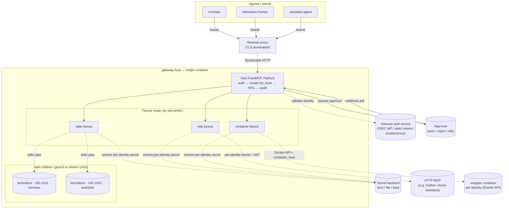

# Architecture

> Sister doc: [`landscape.md`](./landscape.md) for the survey that led to
> "build" instead of adopt. [`README.md`](./README.md) is the quickstart;
> [`CONTRIBUTING.md`](./CONTRIBUTING.md) is the plugin-author guide;
> [`KNOWN_LIMITATIONS.md`](./KNOWN_LIMITATIONS.md) is the honest gap list.

`mcp-gateway` is a **single process** that sits in front of many MCP servers and
adds, per calling identity, the things individual MCP servers don't:
authentication, per-tool authorization, human-in-the-loop (HITL) approvals,
audit logging, and per-identity secret injection + process isolation.

It is **infrastructure-agnostic by construction**: secrets, inbound auth, HITL
approvals, and token refresh are each pluggable behind a small interface, and
the upstream MCPs it federates are reached over one of three transports. None of
the concrete backends are baked in — the image is generic. The Authentik +
OpenBao + ntfy deployment named throughout the [worked example](#appendix-worked-example-authentik-openbao-ntfy)
is the author's homelab; swap any axis without forking.

LiteLLM is not in this picture. Agents drive their own tool-use loops and reach
the gateway directly.

## What the hub adds

For every request, the hub layers five concerns on top of the upstream MCP —
the middleware chain runs in this order:

1. **Inbound auth** — establish *who is calling* via the configured
   [`auth.mode`](#inbound-auth-modes) (OIDC JWT, static token, or trusted
   proxy). The result is an `Identity`.
2. **Tool curation** — `list_tools` returns only the tools whose name matches
   that identity's `allowed_tools` globs. Disallowed tools are **invisible** to
   the agent's LLM, never auto-rejected (the "no-oracle" property — see
   [Security model](#security-model)).
3. **HITL gate** — on `call_tool`, the per-tool policy decides
   `auto-approve` / `push-approve` / `reject`. `push-approve` blocks on an
   operator acknowledgement via the configured [approver](#human-in-the-loop-hitl).
4. **Fanout** — route the call to a per-identity worker for the owning MCP,
   over that MCP's [transport](#transports).
5. **Audit** — one structured line per request at egress (see
   [Audit + observability](#audit--observability)).

## Pluggable axes

Each axis resolves an implementation **by name** from `policy.yaml`. The three
entry-point axes also accept a **dotted path** (`name: my_pkg.module:MyClass`),
so a third-party adapter installs side-by-side and is selected with no fork —
resolution is entry-point first, then dotted-path fallback (see
`src/mcp_hub/secrets/registry.py`, `src/mcp_hub/refresher/registry.py`). See
[`CONTRIBUTING.md`](./CONTRIBUTING.md) for the plugin-author loop.

| Axis | Built-ins | Selected by |
|---|---|---|
| Secrets | `env`, `file` (SOPS/age-friendly), `bao` (Vault/OpenBao) | `secret_backend.name` (group `mcp_hub.secret_backends`) |
| Inbound auth | `oidc` (any JWKS issuer), `static_token` (no IdP), `trusted_proxy` | `auth.mode` |
| Approvals (HITL) | `auto`, `reject`, `ntfy` | `approver.name` (group `mcp_hub.approvers`) |
| Token refresh | `oidc_client_credentials` source, `file` sink | `token_refresh.*.source/sink.type` (groups `mcp_hub.token_sources` / `token_sinks`) |

**Zero-infra mode:** `auth: {mode: static_token}` + `secret_backend: {name: file}`
(or `env`) + `approver: {name: auto}` needs no IdP / Vault / ntfy. See
[`policy.example.minimal.yaml`](./policy.example.minimal.yaml).

### Inbound auth modes

`auth.mode` picks one of three built-in authenticators (the `InboundAuthenticator`
Protocol in `src/mcp_hub/auth.py`); all of them resolve to an identity that must
exist in `policy.yaml` (fail-closed):

- **`oidc`** — validate the inbound `Authorization: Bearer <JWT>` against the
  IdP's JWKS. `jwks_uri` is optional: when omitted it is discovered from
  `<issuer>/.well-known/openid-configuration`. Identity defaults to the `aud`
  suffix after `audience_prefix` (e.g. `mcp-ironclaw` → `ironclaw`); for IdPs
  without a per-identity audience, set `identity_claim` (`sub` / `azp` /
  `client_id`) and optionally `audience` for an exact check.
- **`static_token`** — a YAML `identity: <token>` mapping at `token_file`;
  the bearer is matched in constant time. No IdP required.
- **`trusted_proxy`** — delegate auth to a fronting proxy (oauth2-proxy /
  Authelia / Caddy forward-auth) that sets `identity_header` and echoes a shared
  secret in `x-mcp-gateway-auth`. The hub trusts the header only when the shared
  secret matches.

> `jwt_passthrough`, `secret_bearer` with `as_agent`, and the **container**
> transport need a real inbound JWT, so they require `auth.mode: oidc`.

## Transports

The fanout registers every upstream MCP's tools under a `<mcp>_` prefix and
routes each call to a **per-identity** worker. There are three transports;
**stdio and http need no Docker** — prefer them.

| Transport | Worker | Per-identity auth to upstream | Needs Docker |
|---|---|---|---|
| **stdio** | a child process per (MCP × identity), each `gosu`'d to a distinct UID | secret written to a `0400` file; path passed via `secret_env_name` | no |
| **http** | a forward to an HTTP-transport MCP over the network | `auth: none` / `secret_bearer` (per-identity token in `Authorization`) / `jwt_passthrough` (forward the caller's JWT) | no |
| **container** | a wrapper container per identity, spawned on demand via the Docker API | `jwt_passthrough` to the wrapper; `secrets_to_env` for upstream creds | **yes** (opt-in) |

- **stdio** is the strongest-isolation path: each child runs as its own UID and
  the secret never enters any process's environment (see
  [Security model](#security-model)).
- **http** is the lightest: federate an existing HTTP MCP (a sidecar in the same
  compose stack, or a remote one) with no process management. `secret_bearer`
  supports [as-agent](#identity--secrets) attribution.
- **container** is opt-in and the **only** transport that needs Docker. It
  requires the Docker API reachable by the hub (mount `/var/run/docker.sock` or
  set `DOCKER_HOST` — `docker.from_env()` reads the standard env) **and** a
  `container_host` the hub can use to reach a spawned wrapper's published port.
  `host.docker.internal` (the default) works on Docker Desktop and on Linux
  Docker run with `--add-host=host-gateway`; set `container_host` (e.g. the
  bridge gateway `172.17.0.1`) for rootless Docker / Podman / k8s.

## Component diagram



Containers: **1** (plus opt-in container-transport wrappers). stdio children:
one per (MCP × identity), all siblings in the hub container, isolated by UID.

## End-to-end request flow

1. **Agent → reverse proxy.** POST to `https://<gateway-host>/mcp` with the
   credential the configured `auth.mode` expects (a bearer JWT for `oidc`, a
   static token for `static_token`, or proxy-set headers for `trusted_proxy`).
2. **Reverse proxy** terminates TLS and forwards to the container's `:8443`.
   The credential is the auth; no mTLS required.
3. **Inbound auth** resolves the `Identity` (e.g. JWT signature + `aud`/claim →
   `ironclaw`). Unknown identity → empty `tools/list` and `POLICY_REJECTED` on
   call (no-oracle).
4. **`list_tools`** returns only tools matching the identity's `allowed_tools`
   globs.
5. **`call_tool`** consults the per-tool HITL policy:
   - `reject` → `POLICY_REJECTED`
   - `push-approve` → request approval via the approver; await ack; on timeout
     → `POLICY_HITL_TIMEOUT`
   - `auto-approve` → straight through
6. **Fanout** picks the worker by tool prefix (`technitium_*` → the technitium
   MCP) and dispatches over that MCP's transport (write to a stdio child / HTTP
   call / container wrapper).
7. **Result** bubbles back through fanout → hub → agent. One audit line is
   written at hub egress.

## Security model

The threat model is a **compromised upstream MCP or poisoned tool result** — a
tool-result string with executable content reflected through an MCP's parser —
trying to read another identity's credentials or act beyond its grant.

### Per-UID isolation (stdio transport)

`/proc/<pid>/environ` shows the env passed to `exec()`; even after `unsetenv()`,
the original environ persists in `/proc` and is readable by any process running
as the **same** UID. In a naive single-container fanout where all children share
one UID, a compromised child could `cat /proc/<sibling-pid>/environ` and read a
sibling identity's token.

Mitigations, stacked:

1. **Each stdio child runs as a distinct UID** (`uid_base + per-MCP uid_offset`),
   `gosu`'d at spawn. Linux blocks cross-UID `/proc/*/environ` reads.
2. **Secrets are passed via `0400` token-files, not env vars.** Even within one
   UID the env never held the secret — it holds a *path*; the secret is in a
   file owned by the child's UID.
3. **Forked/wrapped MCPs sanitize their own outputs.** Defense in depth.

The hub starts with just `CAP_SETUID` / `CAP_SETGID` (to `gosu` into the child
UIDs); after spawning, it runs as a single unprivileged UID. The http and
container transports keep the secret out of the hub's own environment the same
way (per-identity resolution, not ambient env).

### No-oracle tool curation

Curation is by *visibility*, not rejection. A disallowed tool is absent from
`tools/list`, and an unknown identity gets an empty list. The hub never reveals
"this tool exists but you can't use it," so `tools/list` can't be used to
enumerate capabilities. (Operationally this can be confusing during setup — see
`KNOWN_LIMITATIONS.md` #12.)

### Security findings, addressed explicitly

| Finding | Mitigation |
|---|---|
| JWT `kid`-as-URL hijack | JWKS resolved against the cached document only (discovered or pinned); explicit `algorithms` allowlist |
| Cross-identity `/proc/environ` exfil | Each stdio child a distinct UID; secrets via `0400` token-files, never env |
| Token in env via `/proc` | Same fix — env holds the *path*, not the secret |
| Approver self-approval if topic guessable | Fixed topic + publish auth; the secret is the backend-stored ack token, not the topic |
| JWKS cache cold-fail | Serve-stale-on-failure for a warm cache; cold-start failure propagates (no fail-open) |
| Sync-blocking HITL polling | Fully async, webhook-driven; per-request timeout |
| Pending HITL evaporates on reboot | TTL'd pending entries in the transient store; restart returns a clean `HITL_TIMEOUT` |
| Hub OOM kills everything | Container memory limits + healthcheck + restart policy; failure mode is "all-down," not "silent half-up" |

## Identity & secrets

Each identity declares its per-MCP secrets, addressed per-(MCP × identity) so the
upstream service sees true attribution (its audit log shows `ironclaw`, not "the
gateway"). Where one shared token is acceptable, identities point at the same
path.

Two identity kinds change *who proves identity to the secret backend*:

- **`delegated`** (default) — a human or client driving tools. The hub is a
  **deputy**: it authenticates to the secret backend with its own service
  identity and reads the per-identity secret on the caller's behalf.
- **`autonomous`** (`kind: autonomous`) — a headless agent acting on its own.
  On MCPs that opt in (`auth.config.as_agent: true`), the agent authenticates to
  the secret backend **as itself** (for the bao backend, a role bound to
  `aud=mcp-<identity>`), so the backend audits the agent rather than the hub's
  deputy. The injected downstream credential is the same per-identity token
  either way; `as_agent` only closes the confused-deputy gap on *who* proved
  identity to the store. This is what makes e.g. an Outline note written by an
  agent attributed to the agent, not the hub.

The secret backend itself is pluggable (`env` / `file` / `bao`); the
[worked example](#appendix-worked-example-authentik-openbao-ntfy) shows the bao
role/path layout.

## Configuration

`policy.yaml` is the single config (path `MCP_HUB_CONFIG`, default
`/etc/mcp-gateway/policy.yaml`). Don't hand-copy from here — start from the
maintained examples:

- [`policy.example.minimal.yaml`](./policy.example.minimal.yaml) — smallest
  working config, no external infra.
- [`policy.example.yaml`](./policy.example.yaml) — full annotated reference
  (OIDC auth, bao secrets, ntfy HITL, token refresh, all three transports,
  delegated + autonomous identities).

The shape, in miniature:

```yaml
version: 1                       # additive-only; see KNOWN_LIMITATIONS #16 / HubConfig.version

auth:
  mode: oidc                     # or static_token / trusted_proxy
  issuer: https://auth.example.com/
  audience_prefix: "mcp-"        # aud suffix = identity (or set identity_claim)

secret_backend: { name: bao, config: { addr: https://secrets.example.com, ... } }
approver:       { name: ntfy, config: { server: https://notify.example.com, topic: mcp-hitl-approvals } }

mcps:
  technitium:                    # stdio transport (default)
    command: ["node", "/app/mcps/technitium/dist/index.js"]
    secret_env_name: TECHNITIUM_TOKEN_FILE
    uid_offset: 10

identities:
  ironclaw:
    aud: mcp-ironclaw
    uid_base: 1001
    allowed_tools: ["technitium_dns_*", "technitium_dhcp_list_*"]
    hitl:
      defaults: auto-approve
      overrides: { technitium_dns_delete_record: push-approve }
    secrets:
      technitium: { path: services/technitium/ironclaw, field: api_token }
```

Placeholders `{identity}` and `{mcp}` expand wherever a path or template appears
(identity secret paths, `path_template`, `secrets_to_env.*.path`,
`audience_template`, the bao `role_template`), unified in
`src/mcp_hub/templating.py`.

## Human-in-the-loop (HITL)

`push-approve` tools block on an operator acknowledgement through the configured
[approver](#pluggable-axes) (`auto` / `reject` / `ntfy`, or a third-party Slack/
Telegram/webhook adapter). The mechanism, with `ntfy` as the worked example:

1. The hub mints a nonce + ack token and stores the pending decision in a
   **transient store** with a TTL (so a hub crash can't leave a call wedged —
   it self-expires to `HITL_TIMEOUT`).
2. It publishes a prompt to a **fixed topic** with Approve/Reject actions whose
   callbacks carry the ack token. Publish auth gates who can post; only the hub
   can mint a valid ack token, so knowing the topic doesn't let an attacker
   self-approve.
3. The operator taps; the approver's webhook route (`WebhookApprover`) resolves
   the pending decision. No polling, no event-loop blocking.
4. On no response within the timeout, the call returns `POLICY_HITL_TIMEOUT`.

Args are hashed in the prompt/audit by default; a per-tool flag unlocks full
args for debugging.

## Image & deployment

The image is **generic and MCP-agnostic** (`ghcr.io/nick-pape/mcp-gateway`,
published by `.github/workflows/image.yml`). It bakes **no MCP servers** — just
the hub venv, `tini` (reaps stdio children), `gosu` (drops to per-identity UIDs),
`curl` (healthcheck), and the pre-created UID range. There is no build-time
`git clone` of upstream MCPs.

```dockerfile
# Two stages: uv-built hub venv → slim runtime. (See ./Dockerfile.)
FROM python:3.13-slim AS hub-build
RUN pip install --no-cache-dir uv
COPY pyproject.toml uv.lock README.md ./
COPY src/ ./src/
RUN uv sync --frozen --no-dev --no-editable

FROM python:3.13-slim AS runtime
RUN apt-get update && apt-get install -y --no-install-recommends \
        ca-certificates curl gosu tini && rm -rf /var/lib/apt/lists/*

# Pre-create the per-identity UID range. Configurable so deployments aren't
# locked to 1001-1099 — bump UID_BASE for rootless subuid maps.
ARG UID_BASE=1001
ARG UID_COUNT=99
RUN for i in $(seq "$UID_BASE" "$((UID_BASE + UID_COUNT - 1))"); do \
        useradd -u "$i" -M -s /usr/sbin/nologin "mcp$i"; done

COPY --from=hub-build /app/.venv /app/.venv
ENTRYPOINT ["/usr/bin/tini", "--", "/usr/local/bin/entrypoint.sh"]
CMD ["python", "-m", "mcp_hub"]
```

**Bringing your own MCPs:**

- **stdio** — layer them onto the base image with a thin
  `FROM ghcr.io/nick-pape/mcp-gateway` overlay (add the runtime + the MCP build,
  reference it in `command:`). The private `ai-pape-house` repo is this homelab's
  overlay (Technitium, Vikunja, …). Nothing about the MCP lives in the base image.
- **http** — run the MCP as a sibling container or remote service and federate it
  with `transport: http`. No overlay, no Docker socket.
- **container** — set `transport: container` + an `image:`; the hub spawns
  wrappers via the Docker API. Needs the socket + `container_host` (above).

To deploy, the broad shape:

1. **Inbound auth** — pick a `mode`. For `oidc`, one provider/audience per
   identity, plus a service identity for the secret backend's login.
2. **Secret backend** (`env` / `file` / `bao`) — each identity's per-MCP secrets,
   e.g. at `services/<mcp>/<identity>`.
3. **`policy.yaml`** — identities, allowed-tool globs, HITL policy, MCPs.
4. **Reverse proxy** — terminate TLS, forward to the container's `:8443`.
5. **MCPs** — overlay (stdio), federate (http), or socket (container) per above.

See [`README.md`](./README.md) and [`docker-compose.yml`](./docker-compose.yml)
for a runnable starting point.

## Audit + observability

JSONL on stderr → log pipeline (e.g. Promtail → Loki).

```json
{
  "ts": "2026-05-05T17:23:01.234Z",
  "request_id": "01HXY...",
  "identity": "ironclaw",
  "method": "tools/call",
  "tool": "technitium_dhcp_set_reservation",
  "args_hash": "sha256:...",
  "decision": "auto-approve",
  "mcp": "technitium",
  "transport": "stdio",
  "status": "ok",
  "duration_ms": 142,
  "hitl_duration_ms": 0
}
```

Args hashed by default; a per-tool policy flag unlocks full args (debugging only).

Error-code taxonomy:

- `POLICY_REJECTED` — tool not in the identity's `allowed_tools` (or unknown identity)
- `POLICY_HITL_REJECTED` — operator rejected the approval
- `POLICY_HITL_TIMEOUT` — operator didn't respond in time
- `AUTH_FAILED` — credential invalid / expired / wrong audience
- `IDENTITY_UNKNOWN` — credential valid but identity not in `policy.yaml`
- `BACKEND_CHILD_DEAD` — a stdio child crashed (see `KNOWN_LIMITATIONS.md` #4)
- `INTERNAL_ERROR` — gateway bug; alert

## Appendix: worked example (Authentik, OpenBao, ntfy)

This is the author's homelab deployment — one concrete instantiation of the
pluggable axes. Each piece is swappable.

### Inbound auth: Authentik OIDC (`auth.mode: oidc`)

One **OAuth2/OpenID Provider** per agent identity, each issuing JWTs with a
distinct audience:

| Provider | Audience | Used by |
|---|---|---|
| `mcp-ironclaw` | `mcp-ironclaw` | IronClaw autonomous agent |
| `mcp-interactive` | `mcp-interactive` | human-driven Claude Code / Cursor |
| `mcp-fanout-svc` | `mcp-fanout-svc` | the hub itself, for bao login |

The hub validates `iss` (Authentik's `issuer_mode=global` puts the same issuer on
every JWT), resolves identity from the `aud` suffix after `audience_prefix:
"mcp-"`, and discovers JWKS from the issuer (or `jwks_uri` pinned per-app — every
app under one signing key returns the same JWKS).

Agents authenticate via `client_credentials` (autonomous), device flow
(interactive Claude Code), or an HTTP node (n8n/scripts). The static
`/oauth/register` shim hands every interactive caller the same `mcp-interactive`
client — sufficient for the homelab, not real DCR (`KNOWN_LIMITATIONS.md` #6).

### Secrets: OpenBao (`secret_backend: {name: bao}`)

For each (MCP × identity), a JWT auth role bound to a policy that reads exactly
one secret path:

```hcl
# bao policy: mcp-technitium-ironclaw
path "secret/data/services/technitium/ironclaw" { capabilities = ["read"] }
```

```hcl
# bao role (role_template "mcp-{mcp}-{identity}")
{ "role_type": "jwt", "user_claim": "sub",
  "bound_audiences": ["mcp-fanout-svc"], "policies": ["mcp-technitium-ironclaw"],
  "ttl": "1h", "max_ttl": "1h" }
```

The hub holds **one** long-lived JWT (`mcp-fanout-svc`); per (MCP × identity) it
swaps that JWT at bao for an ephemeral token scoped to one narrow path, reads the
secret, drops the token (deputy mode). For `autonomous` identities on an
`as_agent: true` MCP, the agent's *own* JWT (role bound to `aud=mcp-<identity>`)
does the swap instead, so bao audits the agent.

Secret layout:

```
secret/services/
  technitium/{ironclaw,interactive}   { api_token: "..." }
  outline/{interactive,assistant-agent}  { api_token: "..." }
```

**Refreshing the hub's JWT.** Authentik bug #16621 silently caps
`access_token_validity`, so the hub rotates its own `fanout_jwt` via the token
refresher: a `oidc_client_credentials` source (RFC 6749; works against any OIDC
IdP — the old `authentik_client_credentials` name is a back-compat alias) → a
`file` sink every ~10 min, which `bao` reads freshly on each login.

### HITL: ntfy (`approver: {name: ntfy}`)

The hub publishes prompts to a fixed topic (`mcp-hitl-approvals`) with Approve/
Reject actions; the operator's phone is subscribed once. Publish auth (token in
the secret backend) gates posting; the ack token (in the transient store with a
TTL) is the actual secret, so the topic being known doesn't allow self-approval.

## Open questions / out of scope

Tracked in detail in [`KNOWN_LIMITATIONS.md`](./KNOWN_LIMITATIONS.md). The
headline gaps and deliberate non-goals:

- **Live policy reload** (#10) — `policy.yaml` changes that add/remove identities
  or MCPs require a restart (HITL-override changes are picked up). A SIGHUP diff
  is the v2 candidate.
- **stdio child failure recovery** (#4) — eager-or-die at boot; no post-boot
  respawn supervision yet.
- **Scale** — per-(MCP × identity) workers are N×M (#7); no `tools/list`
  pagination (#8); per-call JWT verification cost (#9).
- **Deliberately out of scope** — admin UI, DB-backed state, LiteLLM
  integration, multi-instance HA, an internal user model (identities come from
  the external auth source), tool-argument schema rewriting.
